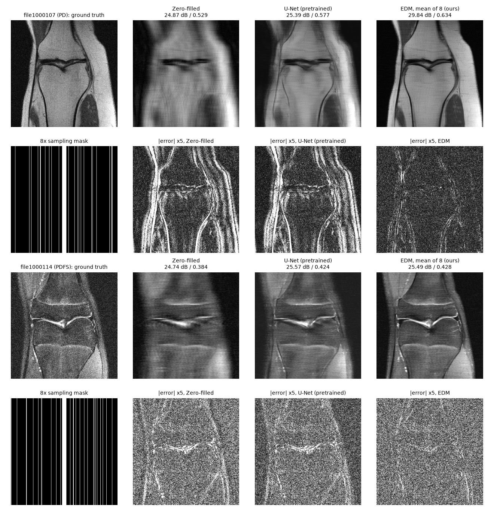
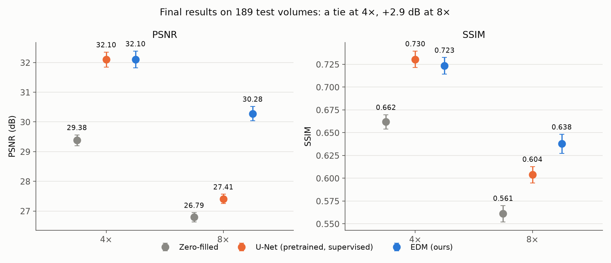
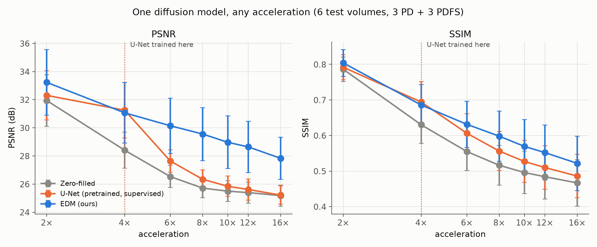

# Diffusion prior for accelerated knee MRI (fastMRI single-coil)

An EDM diffusion model trained from scratch on fastMRI knee single-coil images. It is then used as a prior
to reconstruct undersampled (accelerated) MRI scans, and compared with zero-filling and the official
pretrained fastMRI U-Net.
- The diffusion model never sees undersampled data during training. It only learns what knee images look
  like.
- The measured k-space lines are enforced at reconstruction time.
- So the **same model works at any acceleration**.

Full write-up: [`docs/RESULTS.md`](docs/RESULTS.md) · slide outline: [`docs/PRESENTATION.md`](docs/PRESENTATION.md)

## Results at a glance

189 test volumes (fastMRI validation set minus 10 tuning volumes), central 8 slices, mean over volumes:

| | 4× PSNR / SSIM | 8× PSNR / SSIM |
|---|---|---|
| Zero-filled | 29.38 / 0.662 | 26.79 / 0.561 |
| Pretrained U-Net (supervised, trained for 4×) | 32.10 / **0.730** | 27.41 / 0.604 |
| **EDM (ours, trained from scratch, no paired data)** | **32.10** / 0.723 | **30.28 / 0.638** |

- **4×:** tie with the official supervised baseline (0.00 ± 0.05 dB).
- **8×:** **+2.9 dB** over the baseline, better on 173 of 189 volumes.







## All figures (`docs/figures/`)

| figure | what it shows |
|---|---|
| `kspace_and_masks.png` | the task: skipping k-space lines, and the zero-filled images that result |
| `generated_vs_real.png` | real knee slices vs slices generated from pure noise by the trained model |
| `samples_during_training.png` | generated samples after 1, 2, 3 and 4 million training images |
| `training_loss.png` | training loss, with where reconstructions stopped improving and where training was stopped |
| `loss_per_noise_level.png` | why the loss stays around 0.3: the floor at small noise is the scan's own noise |
| `checkpoint_plateau.png` | reconstruction PSNR vs training length: flat after 1 Mimg |
| `trajectory_8x.png` | one 8× reconstruction emerging from noise over 100 steps |
| `sampler_tuning.png` | the 9 sampler settings tried on the tuning volumes |
| `final_results.png` | final PSNR / SSIM of the three methods at 4× and 8× |
| `final_by_contrast.png` | the same split by PD and fat-suppressed (PDFS) scans |
| `per_volume_scatter.png` | EDM vs U-Net PSNR, one dot per test volume |
| `paired_difference.png` | histogram of the per-volume EDM − U-Net PSNR difference |
| `acceleration_sweep.png` | PSNR / SSIM from 2× to 16×: one diffusion model vs a U-Net trained for 4× |
| `comparison_4x.png`, `comparison_8x.png` | ground truth, zero-filled, U-Net, EDM, error maps and sampling masks |
| `zoom_4x.png`, `zoom_8x.png` | zoom on the joint: smooth supervised output vs sharp diffusion output |
| `uncertainty_4x.png`, `uncertainty_8x.png` | one posterior sample, the mean of 8 and the pixel-wise uncertainty map |

## Repository

- `thesis_exp/`: the code, one file per responsibility.
  - `mri`: FFTs, masks, measurement operator, scaling.
  - `data`: HDF5, cache, dataset, parallel xz unpacking.
  - `edm`: network, preconditioning, loss, sampler, EMA.
  - `train`: loop, checkpoints, distributed helpers.
  - `eval`: metrics, reconstruction, progress checks, U-Net pipeline.
  - `baselines`: the fastMRI U-Net.
- `scripts/`: training, evaluation, tuning, sweep, tables and figures.
- `results/`: every number behind the figures, as JSON or JSONL:
  - training logs;
  - checkpoint comparison;
  - tuning runs;
  - final per-volume metrics for EDM, U-Net and zero-filled;
  - the acceleration sweep.
- `docs/`:
  - `SPEC.md`: every design choice.
  - `BENCHMARK.md`: training throughput.
  - `PROGRESS.md`: notes from the first check.
  - `RESULTS.md`: the full write-up.
  - `PRESENTATION.md`: the slide outline.

**Not included:**
- **The fastMRI data:** request access at https://fastmri.med.nyu.edu/.
- **Model checkpoints:** about 216 MB each, above GitHub's file limit.
- **The pretrained U-Net weights:** download them from
  `https://dl.fbaipublicfiles.com/fastMRI/trained_models/unet/knee_sc_leaderboard_state_dict.pt` into
  `data/pretrained/fastmri_unet/`.

## Reproduce

```bash
# environment
uv venv .venv && VIRTUAL_ENV=.venv uv pip install -e . pytest

# data: resumable download, parallel unpacking (links file from the fastMRI access email)
LINKS=~/fastmri_links.txt bash scripts/download_data.sh
python scripts/preprocess.py data/raw/singlecoil_val data/cache/val
python scripts/preprocess.py data/raw/singlecoil_train data/cache/train

# tests (GPU tests run when a GPU is visible)
python -m pytest -q

# training (resumes from the newest state; touch runs/main/STOP to stop cleanly; ~16 h for 4.1 Mimg on 4 RTX A6000)
GPUS=0,1,2,3 bash scripts/torchrun.sh scripts/train.py --config configs/main.yaml --run-dir runs/main

# sampler tuning on the first 10 validation volumes, then the final evaluation on the other 189
CKPT=runs/main/ema-00004108.pt GPUS=0,1,2,3 GRID="$(cat results/tuning/grid.txt)" bash scripts/tune_recon.sh
GPUS=0,1,2,3 bash scripts/torchrun.sh scripts/evaluate.py --ckpt runs/main/ema-00004108.pt \
    --out runs/main/eval_final --skip 10 train.channels_last=false recon.eta=1.0 recon.num_samples=8

# pretrained U-Net baseline and acceleration sweep
GPUS=0,1,2,3 bash scripts/torchrun.sh scripts/evaluate_unet.py --out runs/baselines/unet
GPUS=0,1,2,3 bash scripts/torchrun.sh scripts/acceleration_sweep.py

# tables and figures (charts need only results/; image figures need the data, the checkpoint and a GPU)
python scripts/compare_results.py --edm runs/main/eval_final --unet runs/baselines/unet
python scripts/make_plots.py
CUDA_VISIBLE_DEVICES=0 python scripts/make_figures.py
```
